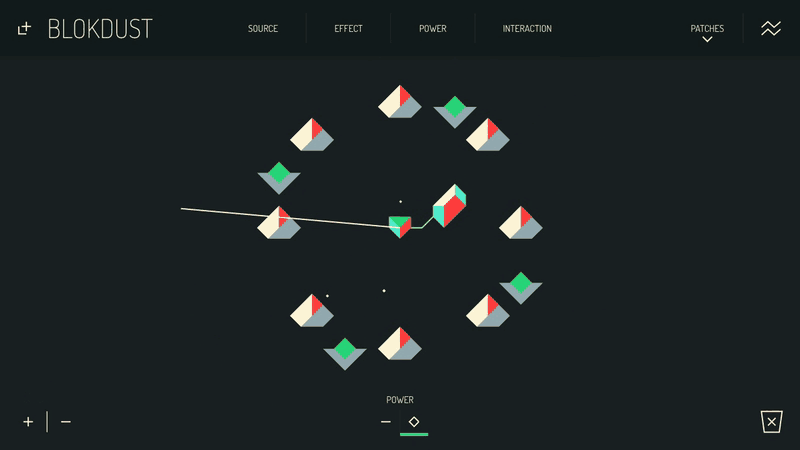

# BlokDust 2

BlokDust is a free, open-source music-making app. Connect blocks to build instruments, create sounds, make effects and design musical worlds that play themselves.

Use it in your browser, as a standalone app, or as a VST3, AU or AUv3 plugin in your favourite music software.

**[Play BlokDust](https://blokdust.funputs.com/)** · **[User Guide](https://blokdust.funputs.com/guide)** · **[Download](https://blokdust.funputs.com/downloads)**

## Features

- Build your own synthesizers, sequencers and audio effects.
- Create music using particles, lasers and moving blocks.
- Play your creations using MIDI and MPE controllers.
- Use audio samples, live audio and your own recordings.
- Save, share and embed your creations on other websites.
- Use BlokDust in Ableton Live, Logic Pro, REAPER and other DAWs.

Everything is free. No account is needed to get started.

## Patch Gallery

Explore, play and remix patches made by the BlokDust community. Create a free account to save your patches across devices and publish your creations to the gallery.

To explore the gallery, open **Patches → Gallery**. To create an account or sign in, open **Settings → Account / Sign In**.

## Download

BlokDust is available on multiple platforms:

- **Web** — play directly in your browser.
- **macOS** — standalone app, VST3 and AU plugins.
- **Windows** — standalone app and VST3 plugin.
- **iPad** — AUv3 plugin, coming soon to the Apple App Store.

Visit the [downloads page](https://blokdust.funputs.com/downloads) or select **Download** in Settings at [blokdust.funputs.com](https://blokdust.funputs.com/).

## Built with

- **C++** – audio engine and physics simulation.
- **JUCE** – native audio plugins and standalone apps.
- **WebAssembly** – audio processing in the browser.
- **TypeScript & PixiJS** – user interface and graphics.
- **Cloudflare Workers & D1** – patch storage and sharing.

## Development

Contributions, bug reports and feature suggestions are welcome.

- [Developer documentation](docs/README.md)
- [Architecture](docs/architecture/overview.md)
- [Build and setup instructions](docs/engineering/toolchain.md)
- [Changelog](CHANGELOG.md)

## Credits

BlokDust was originally created by Luke Twyman, Luke Phillips and Ed Silverton in 2016.

BlokDust 2 was rebuilt by Luke Phillips and released in 2026.

The [original version](https://github.com/BlokDust/BlokDust/tree/v1-legacy) remains available on GitHub.

## Licence

BlokDust 2 is licensed under [AGPL-3.0-or-later](LICENSE). Portions derived from the original BlokDust are licensed under MIT. See [NOTICE.md](NOTICE.md).

The patches you create are yours.
