[BlokDust](/about/) lets you make [synths](/guide/synths/), loops, effects and self-playing scenes. Everything in BlokDust is made from [blocks](/blocks/). You can drag them out of four menus at the top of the stage: [Source](/blocks/categories/source/), [Effect](/blocks/categories/effect/), [Power](/blocks/categories/power/) and [Interaction](/blocks/categories/interaction/). [Open BlokDust](/) and press Start to follow along. The pictures show the original guide’s patches. The [Keyboard Shortcuts](/guide/keyboard-shortcuts/) page covers keys and touchscreen gestures.

## Making a Simple Synth

Blocks in the Source category create sound. There are a few Source blocks we could use for a synth, but we’ll start with the simplest, the [Tone](/blocks/tone/) block. Open Source from the top menu and drag a Tone onto the stage.

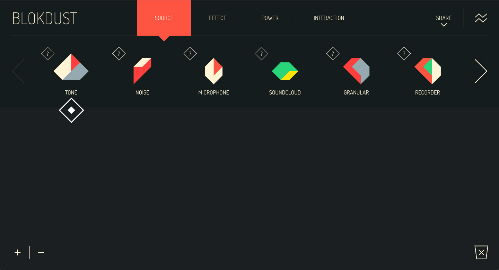

Tone is an oscillator. It generates a sound at a constant pitch. We’ll want to control our Tone, so open Interaction and drag a [Computer Keyboard](/blocks/computer-keyboard/) onto the stage. On a touchscreen, you can use a [Touchpad](/blocks/touchpad/) instead and play the pads in its options.

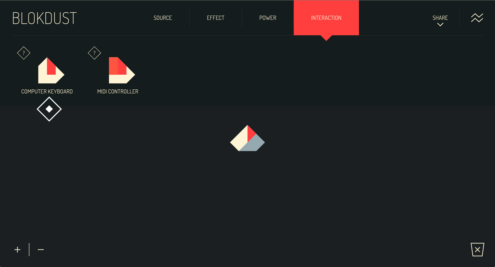

Blocks connect automatically when you bring them close together. Drag the Computer Keyboard near the Tone until a connection line appears.

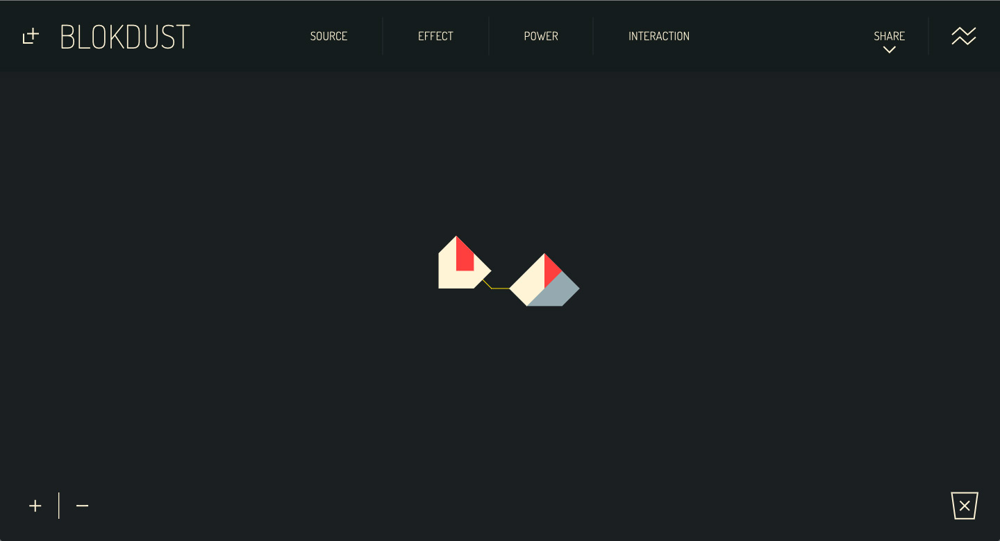

Now that they’re connected, you can play the Tone using your computer keyboard. Give it a go! Open the Effect menu and drag a [Chopper](/blocks/chopper/) near the Tone to make the sound a little more interesting.

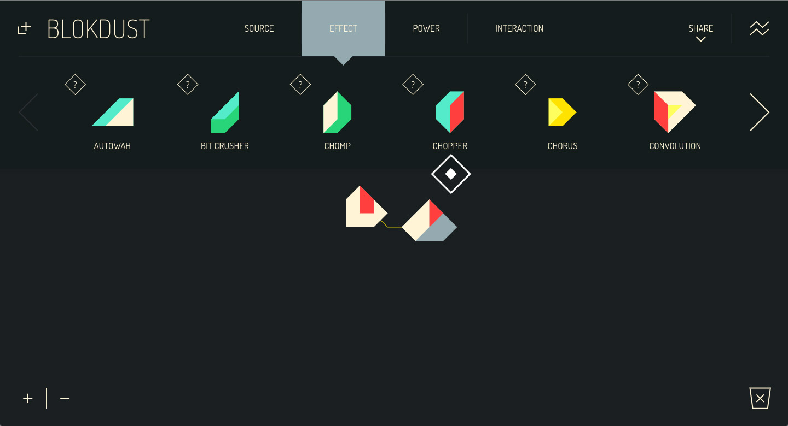

The Chopper creates a tremolo effect, making the sound tremble. Click the Chopper to open its options and have a play with ‘Rate’ and ‘Depth’. You can keep playing the keyboard to hear what they do.

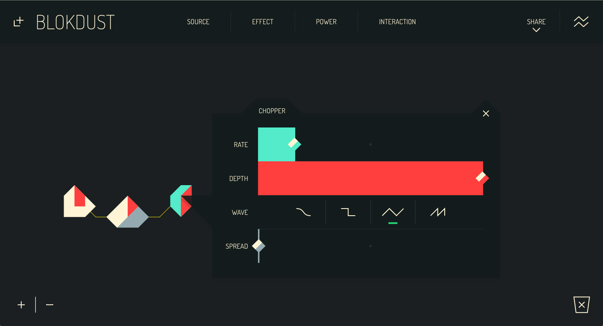

You can drag the stage around to keep a good view of what you’re working on. Try adding [Stereo Delay](/blocks/stereo-delay/) for an echo. Then connect a [Filter](/blocks/filter/) to the Tone, choose low-pass and sweep the frequency from high to low on the graph to hear the sound get darker.

Try another Tone on the same keyboard, or set the Computer Keyboard to polyphonic mode to play chords. When you’ve made something you like, open Patches and use Save to name it and make a link you can share.

## A Self-Playing Scene

Using blocks from the [Power](/blocks/categories/power/) menu, you can make scenes that play by themselves. We’re going to make something melodic using particles. If you’re carrying on from the synth, save it first and clear the stage. Then put three [Tone](/blocks/tone/) blocks in a horizontal line.

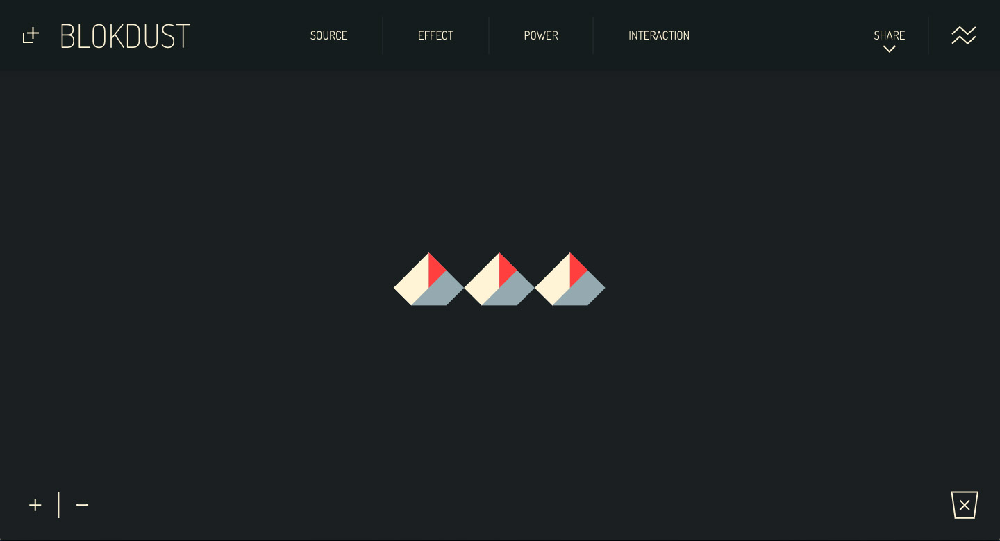

Next we’ll change the sound and pitch of each Tone. Click each one and set ‘Wave’ to sawtooth. Set their notes to C4, A3 and F3. Together those notes make an F major chord.

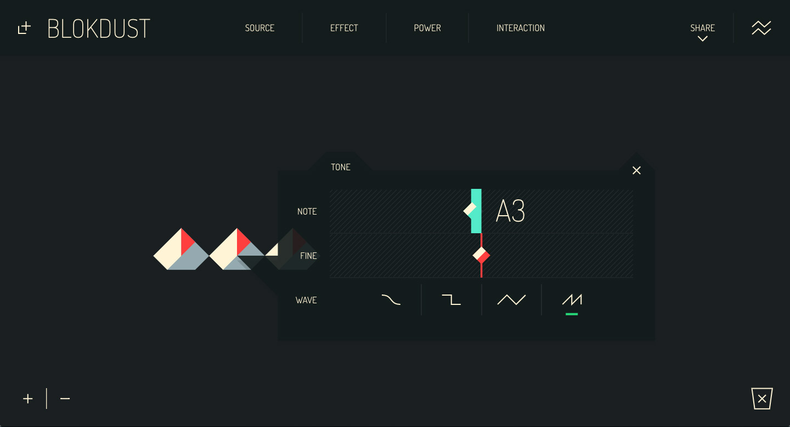

Now add three [Particle Emitters](/blocks/particle-emitter/) from the Power menu. Put them in a line a little way below the Tones, one under each Tone. Aim them up using ‘Angle’. When a particle hits a Tone it will play a short note.

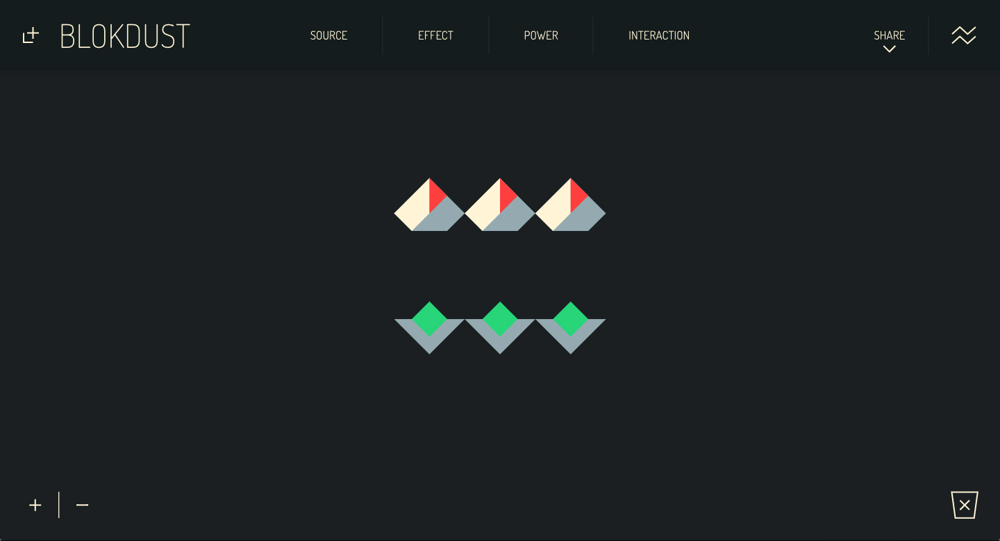

For some variety, turn off Tempo Sync on the emitters and set different ‘Fire Rate’ values. If you’d rather keep them in time, turn on Tempo Sync and try different ‘Division’ or ‘Offset’ values.

The emitters need power. Put a [Toggle Power](/blocks/toggle-power/) just below the middle emitter, close enough to connect to all three. Open its options and switch it on. If any particles miss their Tone, adjust the emitter’s angle or position.

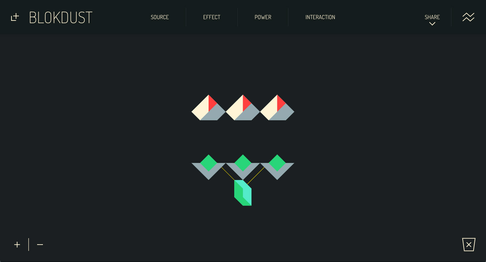

It’s making some noise now, so let’s shape the sound. Put an [Envelope](/blocks/envelope/) just above the middle Tone and check that it connects to all three.

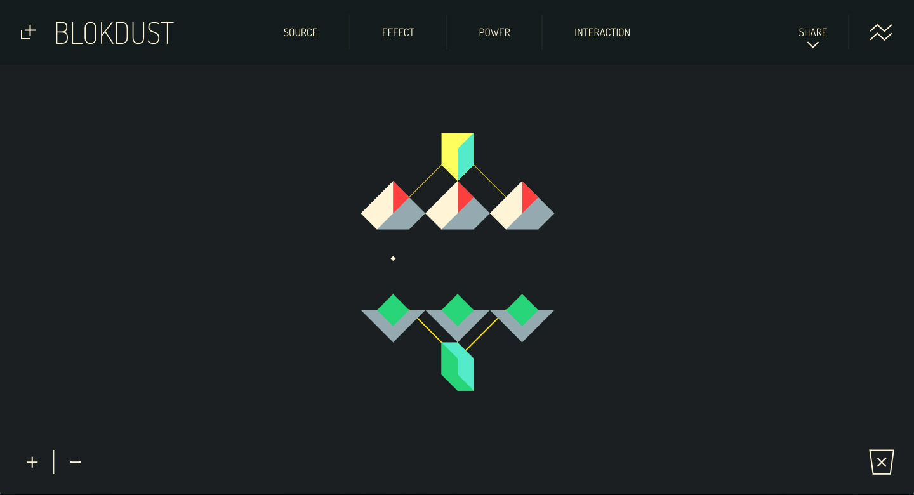

Open the Envelope. Drag the Attack marker at the left towards the start to give the sound a quick attack. Adjust the Release marker at the right so the notes take a little longer to fade out.

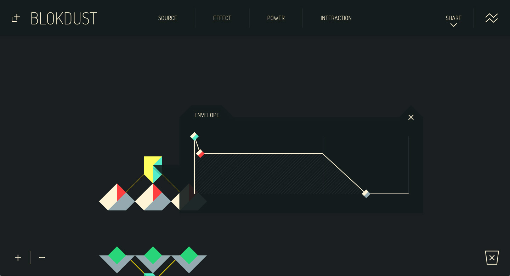

For a different sound, add a couple of [Vibrato](/blocks/vibrato/) blocks near the Tones. Try a slow ‘Rate’ and choose the square wave. Change the ‘Depth’ to hear how far the pitch jumps.

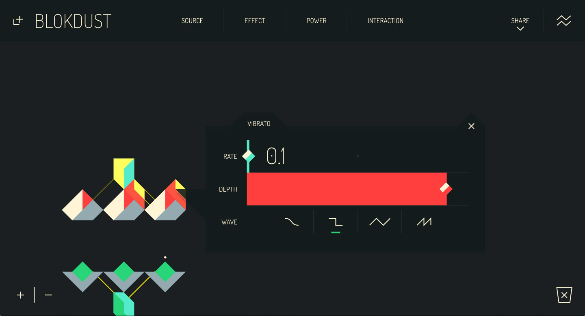

And there it is! The slow square wave changes the pitches as the scene plays. Try [Stereo Delay](/blocks/stereo-delay/) or [Reverb](/blocks/reverb/) for a more spacey sound, or use a [Chomp](/blocks/chomp/) with a low rate for more variation. Try swapping the emitters for a rotating [Laser](/blocks/laser/) and see how it changes the pattern.
